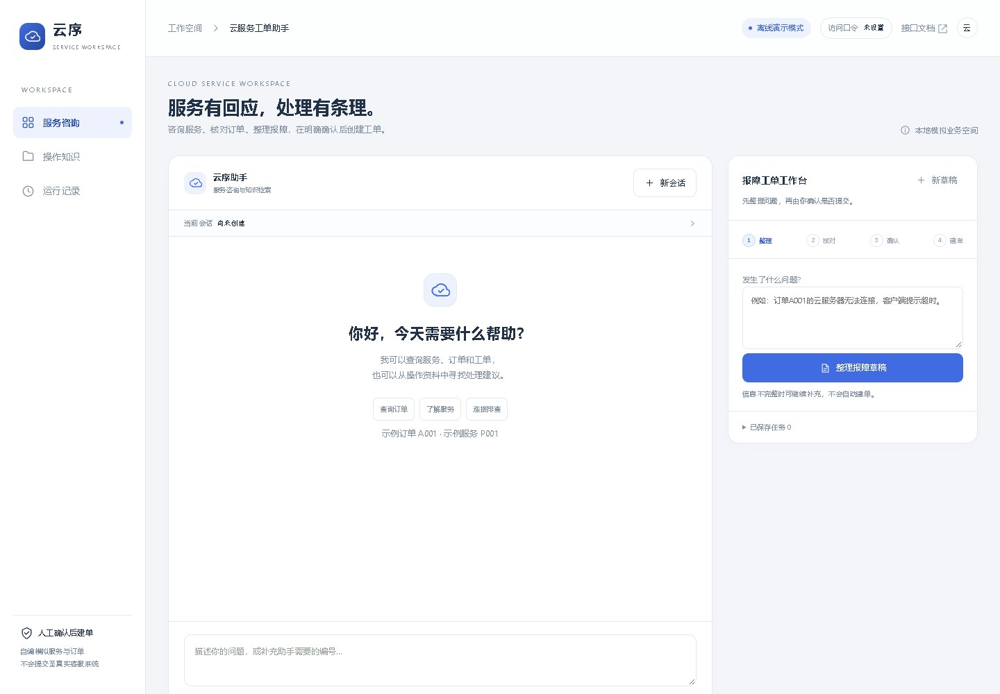

# 云序 · 云服务工单 Agent

将云服务咨询、模拟订单查询、故障排查与工单处理放在一个工作台。用户可以用自然语言查询，也可以把报障内容整理成草稿，经人工确认后创建本地模拟工单。



## 功能

- 查询模拟服务、订单和工单，支持缺字段追问和补充编号后的继续查询。
- 检索自带操作知识，返回可点击的来源引用。
- 通过 SSE 显示工具执行进度和结果。咨询达到轮数上限时可返回已查到的结果。
- 草稿支持补字段、保存版本、确认和取消。重复确认返回同一张工单。
- 会话、任务和执行记录可恢复，容器重启后仍可读取已有工单。

## 快速启动

需要 Python 3.12。在仓库根目录运行：

```bash
python -m pip install -r requirements.txt
python seed_demo.py
python serve.py
```

打开 [工单工作台](http://127.0.0.1:8002/agent) 或 [API 文档](http://127.0.0.1:8002/docs)。默认使用自编业务数据和离线工具路由，无需模型密钥。

使用 Docker Compose 时执行：

```bash
docker compose up --build -d
docker compose exec projects python seed_demo.py
curl -fsS http://127.0.0.1:8002/api/health
```

SQLite 数据保存在 `agent-data` 数据卷，端口默认仅发布到服务器本机。知识检索组件随应用一起运行。

## 体验业务流程

1. 在咨询框输入「查询订单支付状态」。系统追问编号后，补充 `A001`，查看「已支付」与工具执行记录。
2. 在工单区输入「云服务器无法连接」整理草稿。补充 `A001` 并保存后核对当前草稿，再确认建单。
3. 复制生成的工单编号，在咨询区查状态。刷新页面后恢复会话，可以继续查看原任务和工单。
4. 新建另一份草稿并取消，确认任务结束且没有新工单。
5. 咨询「云服务器无法连接应该如何排查」，点击引用核对操作资料。

## 配置

[环境变量示例](.env.example) 列出了运行参数。Python 入口读取进程环境。Compose 支持从本机 `.env` 注入配置。

| 配置项 | 用途 |
| --- | --- |
| `APP_MODE` | `demo` 使用离线路由，`live` 调用真实模型选择工具与整理回复 |
| `APP_DATA` | 本机数据目录，建议按运行模式隔离 |
| `DASHSCOPE_API_KEY`、`MODEL_BASE_URL`、`CHAT_MODEL` | 真实模式的模型服务配置 |
| `EMBEDDING_MODEL_PATH`、`RERANKER_MODEL_PATH` | 可选的本地知识检索模型，先安装 `requirements-local.txt` |
| `APP_TOKEN` | 写接口访问口令，设置后在页面右上角填写同一值 |

运行真实模式前，将 `APP_MODE` 设为 `live`，配置模型密钥和独立数据目录，再执行 `python seed_demo.py` 和 `python serve.py --mode live`。真实模式用于模型工具选择，默认订单查询与工单仍使用自编模拟数据。

## 验证与维护

```bash
python -m pytest tests -q
node tests/test_ui_state.js
python -X utf8 evaluation/eval_agent.py
python -X utf8 -m scripts.demo
```

场景评测覆盖缺参追问、草稿、确认、取消和幂等，报告生成在本机。独立端到端验证可运行 `python -X utf8 -m scripts.verify`。重建知识索引用 `python -X utf8 -m scripts.rebuild_index --data ./runtime`，导出源码用 `python -m scripts.package_source`。

## 项目结构

- `suite/agent.py` 实现咨询循环和工单状态机，`suite/tools.py` 提供查询工具适配。
- `suite/rag.py` 实现内部知识检索，`suite/app.py` 提供 FastAPI 与 SSE 接口。
- `static/` 保存页面，`samples/`、`tests/`、`evaluation/` 保存样例、回归和场景评测。
- [架构与状态流转](docs/architecture.md) 说明工具调用、人工确认、数据存储和执行约束。

工单数据为模拟业务。接入生产系统前需增加用户身份、数据归属、工具鉴权和外部写入对账。仓库采用 [MIT 许可证](LICENSE)。
