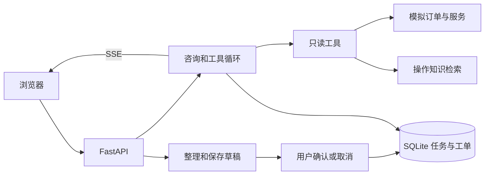

# 架构与状态流转

## 组件

| 层 | 文件 | 职责 |
| --- | --- | --- |
| Web | `static/app.js`、`static/ui.js` | 咨询、SSE、草稿编辑和人工确认 |
| HTTP | `suite/app.py` | 会话、咨询、任务、知识库和执行记录接口 |
| 业务 | `suite/agent.py` | 工具循环、草稿版本、状态转移和幂等 |
| 工具与数据 | `suite/tools.py`、`suite/rag.py`、`suite/core.py` | 模拟服务与订单、内部检索、SQLite 和模型接口 |

## 状态与约束

草稿缺字段时进入 `collecting`，补齐保存后进入 `awaiting_confirmation`。后端确认时检查会话、草稿版本和当前状态，再在同一 SQLite 事务中创建工单并更新任务。终态为 `created` 或 `cancelled`。工单表对任务 ID 有唯一约束，重复确认读取已有工单。

咨询仅允许四个只读工具。模型提议由后端校验后执行。达到工具循环上限时，返回已查到的结果并标记 `partial=true`。真实模型与模拟业务可以组合运行，工单写入始终经过独立的人工确认入口。
